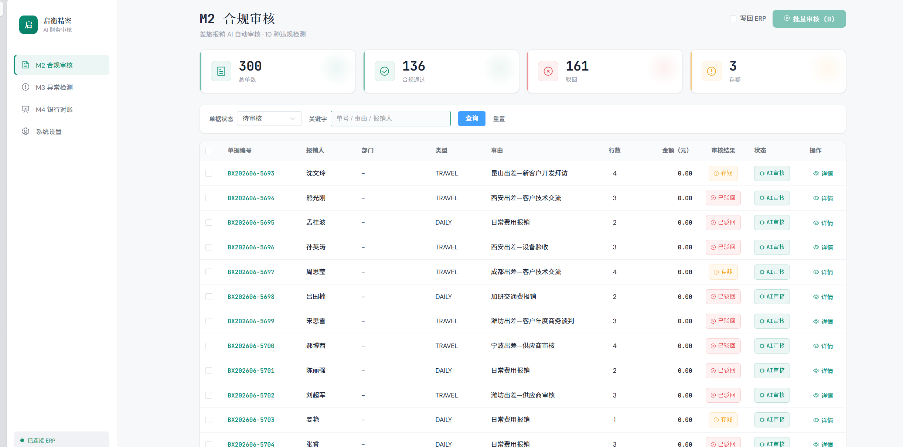
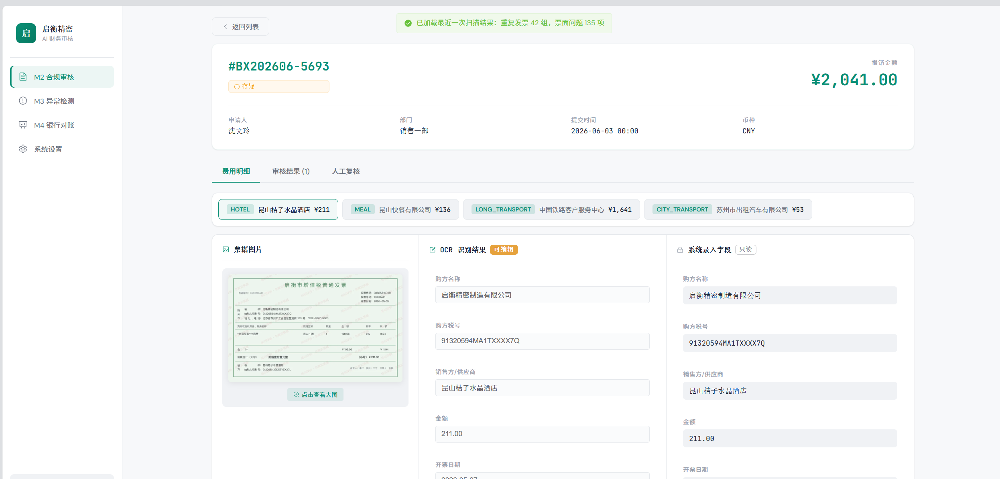
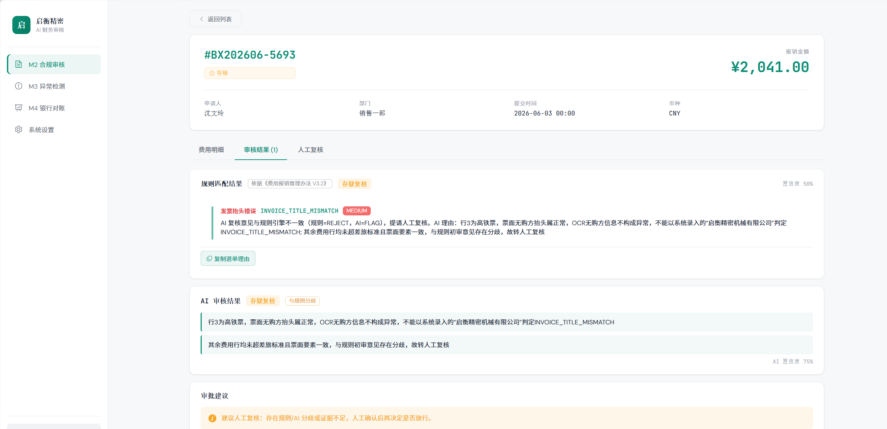
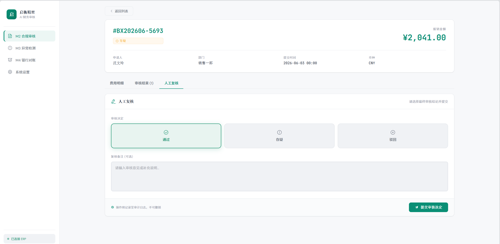
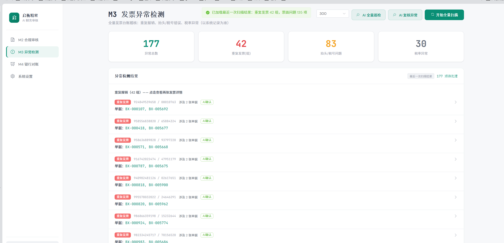
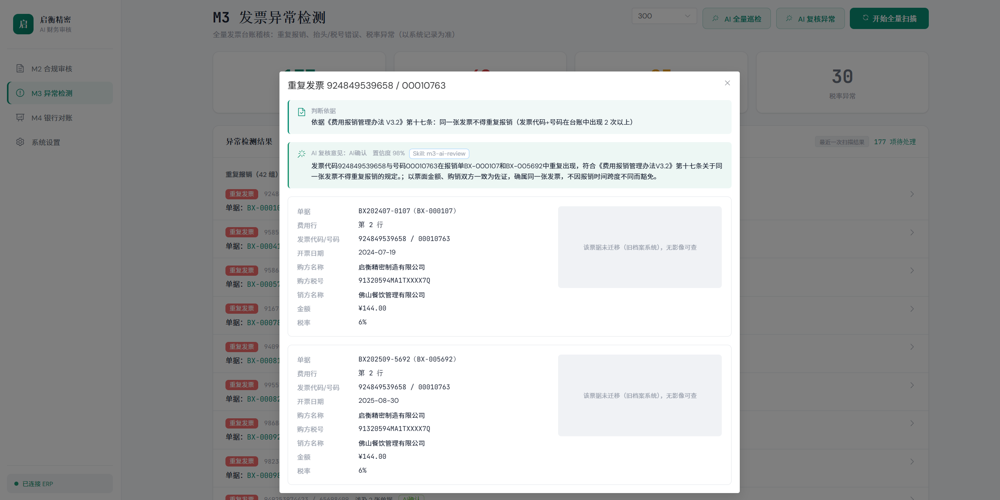
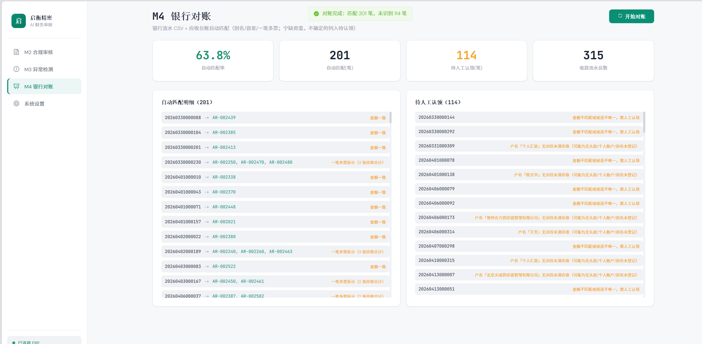

# 启衡精密 AI 财务提效 POC

> 面向制造企业的报销审核、发票稽核与银行对账人机协同系统。规则引擎负责全量兜底，AI 负责复核和取证，财务人员完成最终决定。

这是一个可运行的 AI 财务审核 POC，重点展示三件事：

- **业务闭环**：从待审单据、票面识别、规则审核、AI 复核到人工留痕和意见回写；
- **Agent 边界**：调查工具只读、证据可回溯、预算受控，模型不能自动放行；
- **工程可验证**：公开 Demo 使用合成数据，规则、API、降级、检索和注入防护都有测试入口。

> English summary: An agent-assisted expense audit POC built with Python, FastAPI, Vue 3, LangGraph, local OCR, and hybrid retrieval. The public demo runs on synthetic fixtures without ERP or external model credentials.

## 先跑起来：5 分钟 Demo

要求：Docker Desktop，约 2 GB 可用磁盘。公开 Demo 不需要 ERP、API Key、外部 LLM 或 PaddleOCR 模型下载。

~~~bash
docker compose -f docker-compose.demo.yml up --build
~~~

打开 <http://localhost:5173>。页面会连接本地合成 ERP，内置 6 条报销单、6 条发票和 3 条银行流水，覆盖重复发票、伙食超标、高铁舱位、未知城市和缺附件等场景。

Demo 使用预置票面字段（`OCR_ENGINE=fixture`），默认关闭外部 AI。AI 复核和 Agent 调查可按下方配置单独开启。

停止 Demo：

~~~bash
docker compose -f docker-compose.demo.yml down -v
~~~

后端健康检查：<http://localhost:8000/api/health>。

启动后可以用下面的结果快速确认 Demo 正常工作：

| 模块 | 合成数据与预期现象 |
| --- | --- |
| M2 | 6 条报销单：DEMO-0001/0002/0004/0006 为 REJECT，DEMO-0003/0005 为 FLAG；fixture 不预置 APPROVE 案例，方便直接观察异常和人工关注路径 |
| M3 | 6 条发票：包含一组重复发票，以及购方抬头、税率异常 |
| M4 | 贷方流水 2 条：1 条自动匹配，1 条进入 unidentified；借方流水不参与应收认领 |

## 先看界面

下面的截图来自项目原型展示，数据均为虚拟数据；公开 Demo 使用 `data/demo/` 下另一组合成数据，页面数量和统计会有所不同。点击截图可查看原图。

| M2 审核看板 | 单据详情与票面比对 |
| --- | --- |
|  |  |

| 违规证据与制度依据 | 人工复核与 AI 建议 |
| --- | --- |
|  |  |

| M3 异常列表 | M3 发票异常下钻 |
| --- | --- |
|  |  |

| M4 银行对账 |
| --- |
|  |

## 一条单据如何走完审核

~~~text
选择待审单
  -> 本地 OCR 读取票面字段
  -> 规则引擎执行全量检查
  -> 可选 AI 独立复核 + 制度检索
  -> 分歧 / FLAG 标记人工关注，可选 Agent 调查
  -> 回写审核意见与证据
  -> 财务查看证据并提交人工复核意见，ERP 状态由人工操作
~~~

推荐演示路径：

1. 启动 Demo，打开 M2 页面并连接合成 ERP；
2. 点击批量审核，观察“规则审核 X/N”进度和这组数据的 REJECT / FLAG 结果；
3. 打开单据详情，对照费用行、OCR 票面字段、制度依据和违规理由；
4. 进入人工复核页，提交采纳或覆盖 AI 建议；
5. 切换到 M3，扫描发票台账并下钻重复票、抬头/税号/税率异常；
6. 切换到 M4，查看自动匹配、匹配率和按原因分类的待认领流水。

## 三条业务链路

### M2：差旅报销审核

规则引擎对每个选中单据执行全量检查，覆盖：

- 住宿、伙食、市内交通和长途交通舱位标准；
- 发票抬头、税号、金额和票面字段比对；
- 重复发票、加班打车事前审批、缺附件和差旅科目归集；
- 特批记录豁免，以及未知城市、证据缺失等人工关注场景。

输出固定为 APPROVE、REJECT、FLAG。AI 是第二意见：和规则结论不一致时升级为 FLAG，不会把违规单据静默改成通过。

### M3：全量发票稽核

扫描发票台账，识别重复发票、疑似连号、购方抬头/税号、税率、供应商重复档案和供应商风险画像。每条异常都保留判断依据，支持下钻发票字段和票据影像。

M3 AI 复核是独立的业务 Skill，输出 CONFIRM、DOUBT 或 FALSE_ALARM，并附理由和置信度。字段缺失或证据不足时按 DOUBT 交人工确认。

### M4：银行对账

读取银行 CSV 与应收台账，按客户全称/别名、金额容差和一笔多票规则匹配。只有候选唯一且金额条件满足时才自动确认；多候选、无对应客户、金额不符和重复流水进入待人工认领，并按原因聚合展示。

## Agent 和 Skill 是怎样工作的

~~~text
规则审核 -> 可选 LLM 第二意见 -> 按需只读调查 -> 保守裁决 -> 可选人工 gate -> 意见回写
~~~

调查 Agent 只处理分歧或 FLAG 场景，不是全量自主审批器。工具只能读取差旅标准、制度条款、审批记录、票面字段和发票台账；调用次数、token、超时和证据引用均受约束。调查失败会降级为人工关注，不会阻塞整批任务。

默认使用 `legacy` 管线。显式开启 `M2_PIPELINE=graph` 和 `AGENT_INVESTIGATION_ENABLED=1` 后才运行调查路径；`AGENT_HUMAN_GATE=1` 可使流程暂停，等待人工答复后再回写。

运行时 Skill 位于：

- [doc/skills/m2-claim-review/SKILL.md](doc/skills/m2-claim-review/SKILL.md)：M2 报销单 AI 复核；
- [doc/skills/m3-ai-review/SKILL.md](doc/skills/m3-ai-review/SKILL.md)：M3 发票异常 AI 复核；
- [doc/skills/m2-ai-review/](doc/skills/m2-ai-review/) 与 [doc/skills/m3-invoice-audit/](doc/skills/m3-invoice-audit/)：完整业务工作流和校验脚本。

## 系统架构

~~~text
Vue 3 + Element Plus (5173)
          |
          v
FastAPI (8000) -> Service / Job Store / Artifact Store
          |
          +-> M2 规则 + OCR + RAG + 可选 LLM / LangGraph
          +-> M3 发票台账稽核 + AI 复核
          +-> M4 银行流水 × 应收台账
          +-> Demo ERP Adapter 或真实 ERP 开放平台 Adapter
~~~

核心决策边界：

- 规则引擎是确定性基线，对每个选中单据全量执行；
- LLM 只提供第二意见，不能改变 ERP 审批状态；
- Agent 工具只读，证据必须回溯到工具返回；
- adjudicate 只能向人工关注方向推进；
- 回写的是审核意见和人工留痕，最终放行/驳回仍由人操作。

详细设计见 [系统架构](docs/architecture.md)、[Agent 工作流](docs/agent-workflow.md) 和 [评测说明](docs/evaluation.md)。

## 技术栈

| 层 | 技术 |
| --- | --- |
| 前端 | Vue 3、Vue Router、Pinia、Element Plus、ECharts、Vite |
| 后端 | Python 3.12、FastAPI、Pydantic、SQLite 文件任务存储 |
| 核心引擎 | 规则审核、PaddleOCR 本地识别、RAG 检索、可选 DeepSeek 复核 |
| Agent 编排 | LangGraph、只读工具注册表、grounding 校验、人工 gate |
| 部署 | Docker Compose；公开 Demo 使用合成 ERP 适配器 |

## 目录

~~~text
core/                 规则、OCR、RAG、LLM、Agent 工具和工作流
backend/              FastAPI 路由、服务、任务和持久化
frontend/             Vue 3 + Element Plus 主界面
data/demo/            公开合成 fixture（6 单、6 票、3 条流水）
doc/skills/           M2/M3 业务 Skill 与校验脚本
tools/                评测、Prompt 回归、发布检查和冒烟脚本
tests/unit/           核心单测和契约测试
docs/                 架构、Agent 工作流、评测和工程踩坑
~~~

## 真实 ERP 和 AI 配置（可选）

公开 Demo 不需要真实 ERP 或 API Key。接入自托管 ERP 时：

~~~bash
cp .env.example .env
docker compose up -d --build
~~~

常用开关：

| 变量 | 作用 |
| --- | --- |
| OCR_ENGINE=paddle | 默认本地 PaddleOCR，票据不出域 |
| OCR_ENGINE=qwen | 显式启用云端 OCR，需自行完成数据出域评估 |
| LLM_REVIEW_ENABLED=1 | 启用 AI 第二意见，需配置 LLM_REVIEW_API_KEY |
| M2_PIPELINE=graph | 启用 LangGraph 调查管线 |
| AGENT_INVESTIGATION_ENABLED=1 | 对分歧/FLAG 单启用只读调查 Agent |
| AGENT_HUMAN_GATE=1 | 在图内暂停并等待人工终审 |
| RETRIEVAL_MODE=hybrid | 本地向量 + 关键词混合检索 |

不要把真实 Key 写入代码、issue、日志、截图或 Git 历史。

## 本地开发

仓库已提供完整依赖文件。Windows PowerShell：

~~~powershell
python -m venv .venv
.venv\Scripts\Activate.ps1
pip install -r requirements.txt -r backend/requirements.txt
pip install -e ".[dev]"
python -m pytest
python -m ruff check .
~~~

前端：

~~~powershell
cd frontend
npm install
npm run dev
~~~

## 评测和验证

评测即代码，脚本会读取公开标签或合成 fixture：

~~~bash
python -m pytest
python tools/eval_retrieval.py --mode both
python tools/eval_hard_set.py --gate
python tools/eval_injection.py
python tools/prompt_regression.py
python tools/public_release_check.py
~~~

当前公开验证记录：

- 公开合成 Demo：M2 6 条单据可复现规则结果，M3 可识别重复发票和票面问题，M4 可完成匹配与待认领分类；
- 公开样例规则评测与困难集门禁；
- 注入鲁棒性评测：攻击文本不能静默放行；
- 50 条制度检索标注集：keyword Recall@8 = 0.78，hybrid Recall@8 = 1.00；
- 检索延迟受 CPU、首次模型加载和缓存状态影响，不能脱离运行环境宣称固定 SLA。

## 明确限制

这是学习用途 POC，不是生产财务系统：

- 没有生产级身份认证、RBAC、SSO、多租户和托管密钥系统；
- 没有持久化消息队列、HA worker、完整数据库迁移和跨实例调度；
- POC 连接页会将 ERP 地址/Key 保存在浏览器 localStorage，生产部署应改为后端凭据托管；
- 默认 Demo 使用合成数据，真实数据接入前必须自行完成合规和授权评估。

## 文档与开源规范

- [系统架构](docs/architecture.md)
- [Agent 工作流](docs/agent-workflow.md)
- [评测说明](docs/evaluation.md)
- [数据发布说明](data/README.md)
- [安全策略](SECURITY.md)
- [贡献指南](CONTRIBUTING.md)
- [第三方声明](THIRD_PARTY_NOTICES.md)

## License

代码使用 [MIT License](LICENSE)。依赖、模型权重和外部服务仍受各自许可证与使用条款约束。
